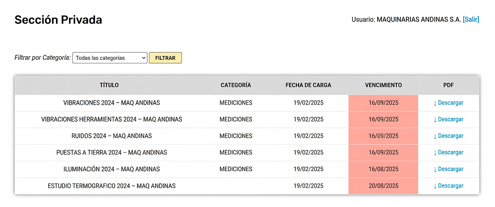
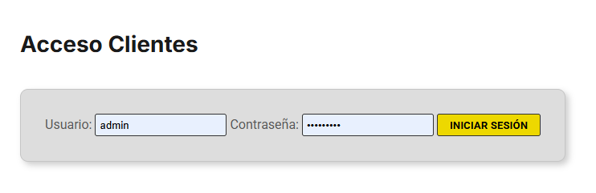

# Certificados

Plugin de WordPress que permite a los clientes iniciar sesión y acceder a una sección privada para descargar sus certificados.

**Versión:** 1.0  
**Autor:** Leandro Lucero  


---

## Descripción

El plugin **Certificados** crea un área exclusiva para clientes donde pueden consultar y descargar los certificados que les hayan sido asignados. Incluye un formulario de login AJAX, un rol de usuario "Cliente" con permisos limitados, un tipo de publicación personalizado para gestionar certificados desde el administrador de WordPress, y un shortcode que muestra el listado de certificados disponibles por usuario.

---

## Características principales

### 1. Área privada de cliente
- Shortcode `[seccion_privada]` que muestra una tabla con los certificados asignados al usuario logueado.
- Cada fila incluye: título, categoría, fecha de carga, fecha de vencimiento y botón de descarga del PDF.
- Las fechas de vencimiento se colorean según su estado:
  - 🟢 **Verde:** más de 90 días restantes.
  - 🟡 **Amarillo:** 90 días o menos.
  - 🔴 **Rojo:** ya vencido.
- Filtro por categoría de certificados mediante desplegable.
- Paginación (50 resultados por página).
- Mensaje cuando el usuario no tiene certificados disponibles.
- Oculta la barra de administración de WordPress para usuarios que no son administradores.



### 2. Login y logout AJAX
- Shortcode `[ajax_login_form]`: formulario de inicio de sesión con envío AJAX (sin recargar la página).
- Mensajes de error mostrados directamente en el formulario.
- Redirección automática a la sección privada tras un login exitoso.
- Shortcode `[logout_link]`: muestra el nombre del usuario logueado y un enlace para cerrar sesión.



### 3. Gestión de certificados desde el admin
- Tipo de publicación personalizado (CPT) llamado **Certificados** con icono de premio (`dashicons-awards`).
- Taxonomía jerárquica **Categorías de Certificados** para organizar los certificados.
- Metabox "Detalles del Certificado" en la edición de cada certificado con:
  - Campo para subir archivo PDF.
  - Campo para fecha de vencimiento.
  - Campo para asignar el certificado a un cliente específico (usuarios con rol "Cliente").
- Columnas personalizadas en el listado de certificados: Cliente asignado y Fecha de Vencimiento (con indicador de color).
- Filtro y ordenamiento por cliente asignado y fecha de vencimiento en el listado del admin.

### 4. Rol de usuario "Cliente"
- Crea el rol `cliente` con capacidades restringidas:
  - Puede leer contenido del sitio.
  - No puede editar ni eliminar publicaciones.
  - No puede subir archivos.

---

## Instalación

1. Copia la carpeta `certificados` en el directorio `wp-content/plugins/` de tu WordPress.
2. Activa el plugin desde el menú **Plugins** de WordPress.
3. Crea usuarios y asígnales el rol **Cliente**.
4. Desde el menú **Certificados** del administrador, crea los certificados y asígnalos a los clientes correspondientes.

---

## Uso de shortcodes

| Shortcode | Descripción |
|-----------|-------------|
| `[seccion_privada]` | Muestra la tabla de certificados privados del usuario logueado. |
| `[ajax_login_form]` | Muestra el formulario de login AJAX para clientes. |
| `[logout_link]` | Muestra el usuario actual y un enlace de cierre de sesión. |

### Ejemplo de uso en una página privada

Crea una página llamada "Sección Privada" y pega el siguiente contenido:

```html
[ajax_login_form]

[seccion_privada]

[logout_link]
```

---

## Estructura de archivos

```
certificados/
├── certificados.php          # Archivo principal del plugin (carga los demás archivos)
├── perfil-cliente.php        # Creación del rol de usuario "Cliente"
├── CPT-certificados.php      # Custom Post Type, taxonomía, metabox y columnas admin
├── seccion-privada.php       # Shortcode del área privada y desactivación de barra admin
├── ajax_login_form.php       # Shortcodes de login/logout y handler AJAX de login
├── ajax-login.css            # Estilos del formulario de login
├── ajax-login.js             # Manejo AJAX del formulario de login
├── seccion-privada.css       # Estilos de la tabla del área privada
└── README.md                 # Este archivo
```

---

## Campos personalizados (meta)

Cada certificado almacena los siguientes meta campos:

| Clave | Descripción |
|-------|-------------|
| `_pdf_certificado` | URL del archivo PDF subido |
| `_fecha_vencimiento` | Fecha de vencimiento del certificado |
| `_usuario_asignado` | ID del usuario cliente al que está asignado |

---

## Requisitos

- WordPress 5.0 o superior
- PHP 7.0 o superior
- El plugin utiliza `wp_upload_bits` para subir archivos, por lo que el directorio `wp-content/uploads` debe tener permisos de escritura.

---

## Notas

- El redireccionamiento tras el login apunta a `home_url('/seccion-privada')` (el dominio del sitio). Puedes modificarlo en `ajax_login_form.php` si es necesario.
- El enlace de "Acceso Clientes" mostrado cuando el usuario no está logueado apunta a `home_url('/acceso-clientes')`. Ajusta la URL en `seccion-privada.php` y `ajax_login_form.php` si es necesario.
- Los certificados solo son visibles para el cliente al que estén asignados.
